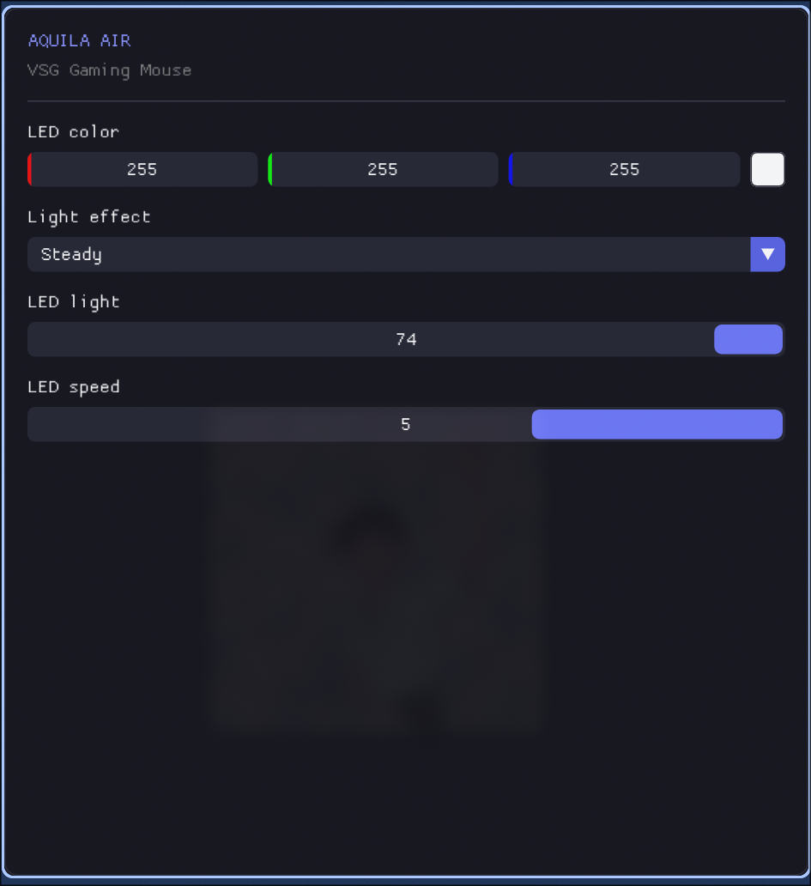

this driver was done by reversing the original binaries of the Aquila Air made for windows

dependencies:
hidapi-devel
glfw-devel
mesa-libGL-devel

build & run:
./build-and-open.sh

the first run installs a udev rule for the mouse (asks for sudo once) so the
driver can run as your user; running the GUI through sudo breaks the display
connection.

